# Blood Mages — Mod Architecture & Subsystem Index

High-density technical specification of the **Blood Mages** mod for Crusader Kings III (`1.20.*`). Designed both for human developers/coding agents and as comprehensive AI context (e.g. Gemini NotebookLM) for system analysis and feature brainstorming.

---

## 1. Mod Architecture Overview

### Guiding Design Pillars
- **Low-Fantasy Occult Integration:** Blood magic operates through native CK3 mechanics (Devotion levels, Piety, lifestyle tracks, skill duels, character modifiers, and story cycles) rather than external mana bars.
- **Earned Power over Godmode:** Immortality, congenital perfection (up to Rank 5), 5★ educations, and flesh-carved Galdrastafir require harvested **Lifeforce**, high **Devotion**, multi-year cooldowns, and contested skill duels with tangible backlash (exhaustion debuffs, wounds, stress, or death).
- **Zero Vanilla Overwrites:** Pure modular additions (`bm_` prefix on all files and keys); 100% compatible with total conversion overhauls (AGOT, Elder Kings, Realms in Exile) via soft doctrine parameters and global variable guards.

### Twin Devotion Classes & Secondary Mastery
Characters awaken to blood magic via hereditary birth, mentoring interactions, witch conversion, or challenging the 100-year-old occult hermit **Egill Skallagrímsson** in Reykjavik or Tsushima (`bm_geyser_duel.0001`). The choice of primary path is **permanent and mutually exclusive**:

| Lifestyle Trait | Archetype | Exclusive Tracks (2) | Shared Devotion Tracks (3) | Magic & Subsystem Access |
| --- | --- | --- | --- | --- |
| **Blood Mage** (`lifestyle_blood_mage`) | *Shepherd of the Faithful* — Occult scholar, dynasty architect, scheme master | `bloodline` (Domain limit, tax, build speed/cost, dev) `hematurgy` (Hostile schemes, dread, tyranny reduction) | `ancient` (Longevity, lifestyle XP, health penalty negation) `enlightenment` (Piety, learning per piety level) `benediction` (Opinion, prestige, diplomacy per piety level) | Casts **Minor**, **Major**, and **Superior** Blood Magic; builds **Blood Universities** (`bm_university_0..3`); inscribes Superior Blood Runes on others. |
| **Blood Knight** (`lifestyle_blood_knight`) | *Fire and Sword* — Martial warlord, battlefield harvester, champion | `vanguard` (Advantage, army speed, martial & martial/piety) `slaughter` (Prowess, knight limit & effectiveness, prowess/piety) | `ancient`, `enlightenment`, `benediction` *(identical to Blood Mage)* | Casts **Minor**, **Major**, and **Superior** Blood Magic; harvests Lifeforce from **battle victories**, **single-combat kills**, and **ambient yearly pulses**; empowers sworn Blood Knights. |
| **Blood Empowerment** (`lifestyle_blood_empowerment`) | *Secondary Personal Mastery* — Granted alongside Mage and Knight traits (base 0 XP); advanced via Major Magic | 5 independent tracks: `dynasty` (fertility/genetics), `mastery` (XP/languages), `presence` (opinion/stress), `prosperity` (income), `shadows` (secrecy/plot defense) | — | Each track capped at 100 XP grants `+5%` Devotion Impact (`piety_level_impact_mult`, stacking up to `+25%`) and `no_prowess_loss_from_age = yes`. |

### Core Gameplay Loop & Subsystem Interconnections

```mermaid
flowchart LR
    subgraph Sources ["1. Lifeforce & Piety Generation"]
        H1["Prisoner / Courtier Lifedrain"]
        H2["Manifest / Condense / Distill Rites"]
        H3["Battlefield & Duel Kills (Knight / Ægishjálmur)"]
        H4["Yearly Pulse: Blood Runes & Knight Ambient"]
        H5["Seek Power Wilderness Expeditions"]
    end

    subgraph Resource ["2. Lifeforce Reserves"]
        LF["Minor / Major / Superior Lifeforce\n(Stacking permanent health & lifespan buffs\nuntil consumed for casting)"]
    end

    subgraph Sinks ["3. Spellcasting & Ritual Sinks"]
        G1["Minor Blood Magic (Attunement Decision, Purge, Condense, Minor Rune)"]
        G2["Major Grimoire (Empowerment, Edu 1-4★, Major Rune, Bloodline, Traits 1-2)"]
        G3["Superior Grimoire (Master 5★ / 2nd Edu, Superior Rune, Traits 3-5, Golem)"]
        I1["Interactions (Heal 37 Ailments, Trait Theft, Bless Kin, Curse, Inscribe Rune, Initiate)"]
    end

    subgraph Progression ["4. Long-Term Progression & World Systems"]
        P1["12 Lifestyle Tracks (10–100 XP)\n• Vitality Baseline (Tiers 10–40, 60–90)\n• 50 XP Devotion Scaling Milestones\n• 100 XP Capstones: Level 6–8 Devotion & Age Prowess Lock"]
        P2["5 Galdrastafir Blood Runes (Minor -> Major -> Superior Capstones)"]
        P3["7 Dynasty House Modifiers + Immortal Blood Golems (bm_house_golem)"]
        P4["5-Tier Blood Shrine Domicile + Blóðtrú / Ketsudō / Xuédào Faiths"]
    end

    Sources --> LF
    LF --> Sinks
    Sinks -->|Awards Track XP + Temporary Backlash| Progression
```

---

## 2. Path to Architecture Doc

| Source Path | Architecture Document |
| --- | --- |
| `common/decisions/bm_*`, `common/character_interactions/bm_*` | [`blood-mage-magic-tiers.md`](file:///Users/clarabotet/Documents/Paradox%20Interactive/Crusader%20Kings%20III/mod/ck3_blood_mage/docs-ai/architecture/blood-mage-magic-tiers.md) |
| `common/traits/bm_*_trait.txt` | [`blood-mage-traits.md`](file:///Users/clarabotet/Documents/Paradox%20Interactive/Crusader%20Kings%20III/mod/ck3_blood_mage/docs-ai/architecture/blood-mage-traits.md), [`blood-mage-blood-empowerment.md`](file:///Users/clarabotet/Documents/Paradox%20Interactive/Crusader%20Kings%20III/mod/ck3_blood_mage/docs-ai/architecture/blood-mage-blood-empowerment.md), [`blood-mage-blood-knight.md`](file:///Users/clarabotet/Documents/Paradox%20Interactive/Crusader%20Kings%20III/mod/ck3_blood_mage/docs-ai/architecture/blood-mage-blood-knight.md) |
| `common/scripted_effects/bm_trait_track_xp_gain_effects.txt`, `common/script_values/bm_xp_requirement_values.txt`, `bm_cure_illness_values.txt`, `bm_drain_piety_cost.txt` | [`blood-mage-track-xp.md`](file:///Users/clarabotet/Documents/Paradox%20Interactive/Crusader%20Kings%20III/mod/ck3_blood_mage/docs-ai/architecture/blood-mage-track-xp.md) |
| `common/modifiers/bm_lifeforce.txt`, `bm_blood_magic_*_effects.txt`, `common/on_action/bm_combat_on_actions.txt`, `bm_combat_effects.txt` | [`blood-mage-lifeforce.md`](file:///Users/clarabotet/Documents/Paradox%20Interactive/Crusader%20Kings%20III/mod/ck3_blood_mage/docs-ai/architecture/blood-mage-lifeforce.md) |
| `common/modifiers/bm_blood_runes_modifiers.txt`, `bm_blood_runes_effects.txt`, `bm_inscribe_rune_other.txt`, `events/bm_blood_runes_events.txt`, `common/buildings/bm_duchy_buildings.txt` | [`blood-mage-blood-runes.md`](file:///Users/clarabotet/Documents/Paradox%20Interactive/Crusader%20Kings%20III/mod/ck3_blood_mage/docs-ai/architecture/blood-mage-blood-runes.md) |
| `common/decisions/bm_*` | [`blood-mage-decisions.md`](file:///Users/clarabotet/Documents/Paradox%20Interactive/Crusader%20Kings%20III/mod/ck3_blood_mage/docs-ai/architecture/blood-mage-decisions.md) |
| `common/character_interactions/bm_*`, `common/important_actions/bm_important_actions.txt` | [`blood-mage-interactions.md`](file:///Users/clarabotet/Documents/Paradox%20Interactive/Crusader%20Kings%20III/mod/ck3_blood_mage/docs-ai/architecture/blood-mage-interactions.md) |
| `bm_drain_trait_effects.txt`, `bm_education_duel_effect.txt`, `bm_manifest_traits_effects.txt`, `common/script_values/bm_drain_duel_values.txt`, `bm_education_enhancement_piety_cost.txt` | [`blood-mage-duels-and-education.md`](file:///Users/clarabotet/Documents/Paradox%20Interactive/Crusader%20Kings%20III/mod/ck3_blood_mage/docs-ai/architecture/blood-mage-duels-and-education.md) |
| `bm_golem_duel_effect.txt`, `bm_golem_piety_values.txt`, `events/bm_blood_golem_events.txt` | [`blood-mage-golems.md`](file:///Users/clarabotet/Documents/Paradox%20Interactive/Crusader%20Kings%20III/mod/ck3_blood_mage/docs-ai/architecture/blood-mage-golems.md) |
| `common/dynasty_houses/`, `common/dynasties/`, `bm_channel_dynasty_modifiers.txt` | [`blood-mage-dynasty.md`](file:///Users/clarabotet/Documents/Paradox%20Interactive/Crusader%20Kings%20III/mod/ck3_blood_mage/docs-ai/architecture/blood-mage-dynasty.md) |
| `common/domiciles/buildings/bm_domicile_buildings.txt`, `common/modifiers/bm_domicile_modifiers.txt` | [`blood-mage-domicile-buildings.md`](file:///Users/clarabotet/Documents/Paradox%20Interactive/Crusader%20Kings%20III/mod/ck3_blood_mage/docs-ai/architecture/blood-mage-domicile-buildings.md) |
| `common/religion/**`, `bm_religion_conversion_effects.txt`, `bm_reformation_repair_*` | [`blood-mage-religions.md`](file:///Users/clarabotet/Documents/Paradox%20Interactive/Crusader%20Kings%20III/mod/ck3_blood_mage/docs-ai/architecture/blood-mage-religions.md) |
| `common/story_cycles/bm_blood_mage_story.txt`, `bm_blood_mage_story_list_effects.txt`, `bm_blood_mage_story_values.txt` | [`blood-mage-story.md`](file:///Users/clarabotet/Documents/Paradox%20Interactive/Crusader%20Kings%20III/mod/ck3_blood_mage/docs-ai/architecture/blood-mage-story.md) |
| `common/on_action/bm_blood_mage_prevalence_on_actions.txt`, `bm_yearly_pulse.txt`, `common/scripted_effects/bm_blood_mage_lifecycle_effects.txt` | [`blood-mage-prevalence-and-lifecycle.md`](file:///Users/clarabotet/Documents/Paradox%20Interactive/Crusader%20Kings%20III/mod/ck3_blood_mage/docs-ai/architecture/blood-mage-prevalence-and-lifecycle.md) |
| `common/game_rules/bm_game_rules.txt` | [`blood-mage-game-rules.md`](file:///Users/clarabotet/Documents/Paradox%20Interactive/Crusader%20Kings%20III/mod/ck3_blood_mage/docs-ai/architecture/blood-mage-game-rules.md) |
| `events/bm_*` | [`blood-mage-events-overview.md`](file:///Users/clarabotet/Documents/Paradox%20Interactive/Crusader%20Kings%20III/mod/ck3_blood_mage/docs-ai/architecture/blood-mage-events-overview.md) |
| `common/scripted_triggers/bm_triggers.txt`, `common/opinion_modifiers/`, `common/nicknames/`, `common/deathreasons/`, `gui/*texticons*` | [`blood-mage-shared-scripting.md`](file:///Users/clarabotet/Documents/Paradox%20Interactive/Crusader%20Kings%20III/mod/ck3_blood_mage/docs-ai/architecture/blood-mage-shared-scripting.md) |

---

## 3. Subsystem Reference Catalog

| Document | Subsystem Coverage |
| --- | --- |
| [`blood-mage-magic-tiers.md`](file:///Users/clarabotet/Documents/Paradox%20Interactive/Crusader%20Kings%20III/mod/ck3_blood_mage/docs-ai/architecture/blood-mage-magic-tiers.md) | Complete breakdown of Minor, Major, and Superior Blood Magic: requirements, costs, XP gains, effects, and class access |
| [`blood-mage-traits.md`](file:///Users/clarabotet/Documents/Paradox%20Interactive/Crusader%20Kings%20III/mod/ck3_blood_mage/docs-ai/architecture/blood-mage-traits.md) | Core lifestyle traits (`lifestyle_blood_mage`, `lifestyle_blood_knight`, `lifestyle_blood_empowerment`), all 12 tracks cumulative benefits (10/50/100 XP), and initiation routes |
| [`blood-mage-blood-knight.md`](file:///Users/clarabotet/Documents/Paradox%20Interactive/Crusader%20Kings%20III/mod/ck3_blood_mage/docs-ai/architecture/blood-mage-blood-knight.md) | `lifestyle_blood_knight` martial Devotion peer: 5 tracks, battlefield & duel Lifeforce harvesting, retinue empowerment, and full Superior Magic parity |
| [`blood-mage-blood-empowerment.md`](file:///Users/clarabotet/Documents/Paradox%20Interactive/Crusader%20Kings%20III/mod/ck3_blood_mage/docs-ai/architecture/blood-mage-blood-empowerment.md) | Secondary `lifestyle_blood_empowerment` trait: 5 tracks (`dynasty`, `mastery`, `presence`, `prosperity`, `shadows`), Devotion impact capstones, and Versatility fallback |
| [`blood-mage-track-xp.md`](file:///Users/clarabotet/Documents/Paradox%20Interactive/Crusader%20Kings%20III/mod/ck3_blood_mage/docs-ai/architecture/blood-mage-track-xp.md) | Master XP catalog across all 12 tracks: Piety costs, Lifeforce sinks/sources, ritual gates, and XP yields |
| [`blood-mage-lifeforce.md`](file:///Users/clarabotet/Documents/Paradox%20Interactive/Crusader%20Kings%20III/mod/ck3_blood_mage/docs-ai/architecture/blood-mage-lifeforce.md) | Lifeforce resource economy: Minor/Major/Superior modifiers, exhaustion durations, battlefield troop-scaling brackets, and sources/sinks matrix |
| [`blood-mage-blood-runes.md`](file:///Users/clarabotet/Documents/Paradox%20Interactive/Crusader%20Kings%20III/mod/ck3_blood_mage/docs-ai/architecture/blood-mage-blood-runes.md) | 5 Icelandic Galdrastafir staves across Minor/Major/Superior tiers, 5 Superior Capstones, other-inscription interaction, flay swap rite, and Blood Universities 0–3 |
| [`blood-mage-decisions.md`](file:///Users/clarabotet/Documents/Paradox%20Interactive/Crusader%20Kings%20III/mod/ck3_blood_mage/docs-ai/architecture/blood-mage-decisions.md) | Master decisions table: Situation & Decisions tab integration, costs, cooldowns, requirements, XP gains, and effects |
| [`blood-mage-interactions.md`](file:///Users/clarabotet/Documents/Paradox%20Interactive/Crusader%20Kings%20III/mod/ck3_blood_mage/docs-ai/architecture/blood-mage-interactions.md) | Master character interactions table: draining, trait theft, 37-condition healing & Situation alert, rune carving on others, blood curses, and AI targeting vetoes |
| [`blood-mage-duels-and-education.md`](file:///Users/clarabotet/Documents/Paradox%20Interactive/Crusader%20Kings%20III/mod/ck3_blood_mage/docs-ai/architecture/blood-mage-duels-and-education.md) | Geyser initiation duels, Ex-Nihilo Congenital Trait Manifestation (Ranks 1–5), Prisoner Trait Theft math, Education Enhancement (1★–5★ & 2nd Education), and Mass Lifedrain |
| [`blood-mage-golems.md`](file:///Users/clarabotet/Documents/Paradox%20Interactive/Crusader%20Kings%20III/mod/ck3_blood_mage/docs-ai/architecture/blood-mage-golems.md) | Immortal Blood Golem constructs: creation decision, `blood_golem_template` stats, shaping duel trait/cost table, and `bm_house_golem` roster |
| [`blood-mage-dynasty.md`](file:///Users/clarabotet/Documents/Paradox%20Interactive/Crusader%20Kings%20III/mod/ck3_blood_mage/docs-ai/architecture/blood-mage-dynasty.md) | 7 permanent supernatural House modifiers, stacking Legacy bloodline, yearly Bloodline XP feedback loop, and Golem house |
| [`blood-mage-domicile-buildings.md`](file:///Users/clarabotet/Documents/Paradox%20Interactive/Crusader%20Kings%20III/mod/ck3_blood_mage/docs-ai/architecture/blood-mage-domicile-buildings.md) | 5-tier Blood Shrine external domicile line (`camp` & `estate`), scaling piety/health/lifespan/genetics, and camp/court-wide follower aura |
| [`blood-mage-religions.md`](file:///Users/clarabotet/Documents/Paradox%20Interactive/Crusader%20Kings%20III/mod/ck3_blood_mage/docs-ai/architecture/blood-mage-religions.md) | `rf_blodtru` family (`blodtru_faith`, `ketsudo_faith`, `xuedao_faith`), shared tenets, Eminent vs. Regular holy site modifiers, and hidden `blood_magic_cult_faith` doctrine |
| [`blood-mage-story.md`](file:///Users/clarabotet/Documents/Paradox%20Interactive/Crusader%20Kings%20III/mod/ck3_blood_mage/docs-ai/architecture/blood-mage-story.md) | `bm_blood_mage_story` Situation panel, real-time discipline/Lifeforce/Rune status display, and character rosters (Dynasty Mages, Blood Knights, Blood Golems) |
| [`blood-mage-prevalence-and-lifecycle.md`](file:///Users/clarabotet/Documents/Paradox%20Interactive/Crusader%20Kings%20III/mod/ck3_blood_mage/docs-ai/architecture/blood-mage-prevalence-and-lifecycle.md) | Mandatory entry effects, 25%/100% non-genetic inheritance rules, birth pipeline, and AI prevalence retention audits |
| [`blood-mage-game-rules.md`](file:///Users/clarabotet/Documents/Paradox%20Interactive/Crusader%20Kings%20III/mod/ck3_blood_mage/docs-ai/architecture/blood-mage-game-rules.md) | All 8 campaign game rules: Mage/Knight prevalence, portrait alterations, Blóðtrú availability, starting counties/holders (Iceland & Tsushima), initiation gates, and AGOT lore |
| [`blood-mage-events-overview.md`](file:///Users/clarabotet/Documents/Paradox%20Interactive/Crusader%20Kings%20III/mod/ck3_blood_mage/docs-ai/architecture/blood-mage-events-overview.md) | Complete event file, namespace, trigger, and outcome matrix across all 20 event files |
| [`blood-mage-shared-scripting.md`](file:///Users/clarabotet/Documents/Paradox%20Interactive/Crusader%20Kings%20III/mod/ck3_blood_mage/docs-ai/architecture/blood-mage-shared-scripting.md) | Cross-cutting triggers, opinion modifiers, death reasons, nicknames, UI text icons, and overhaul compatibility guards |
