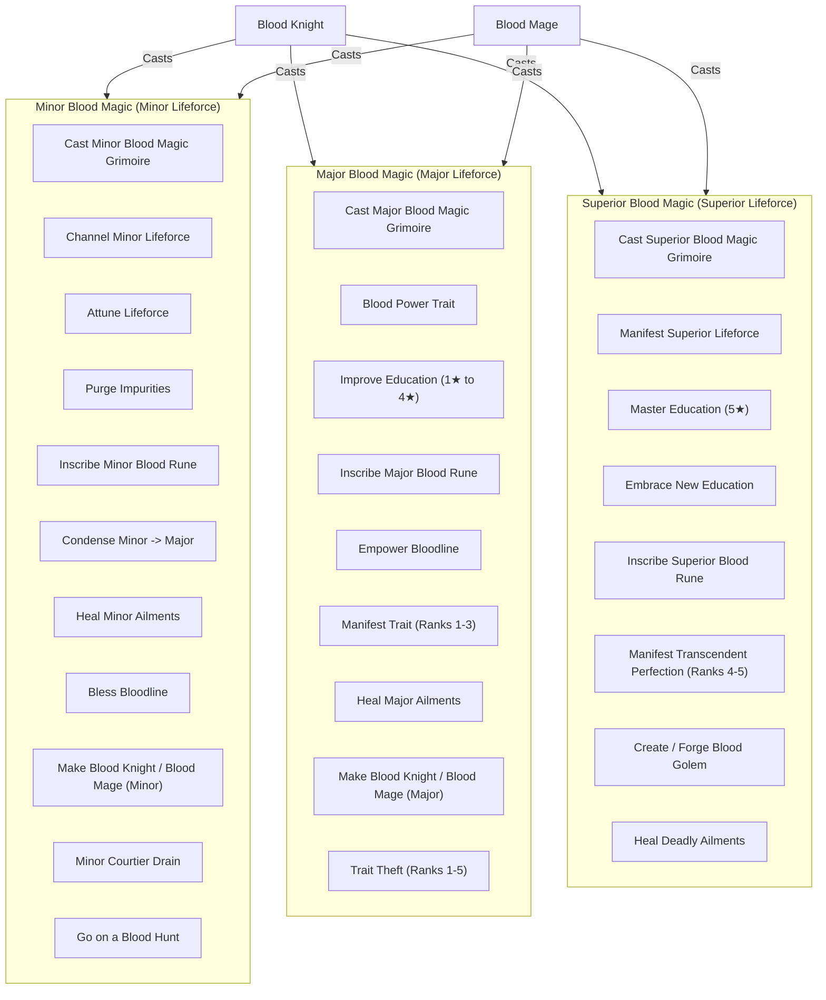

# Blood Magic Tiers

Living technical specification of the three Blood Magic tiers: Minor, Major, and Superior.

## Core Hierarchy

- **Blood Knight (`lifestyle_blood_knight`)**: Devotion-anchored martial peer (*Fire and Sword*). Casts **Minor Magic**, **Major Magic**, and **Superior Magic**.
- **Blood Mage (`lifestyle_blood_mage`)**: Devotion-anchored occult peer (*Shepherd of the Faithful*). Casts **Minor Magic**, **Major Magic**, and **Superior Magic**.

---

## Tier 1: Minor Blood Magic

Requires Minor Lifeforce (`lifeforce_modifier_minor`). Accessible to both **Blood Mages** and **Blood Knights**.

| Action / Ritual | Interface | Cost / Prerequisite | Effect | XP Gain |
| --- | --- | --- | --- | --- |
| **Cast Minor Blood Magic** | Decision Widget (`bm_cast_blood_magic_minor_decision`) | Minor Lifeforce | Opens minor rituals option-list decision widget. | None |
| **Channel Minor Lifeforce** | Decision Option | 75 Piety + Minor Lifeforce | Grants 5-year stat buff event chain (`bm_channel_lifeforce_enlightenment_minor.001`) with +10 monthly (+30 quarterly) Lifestyle XP in the chosen attribute's discipline (or +5 monthly to active focus for Experience Gain). | +1 Enlightenment |
| **Attune Lifeforce** | Decision (`bm_attune_lifeforce_decision`) | First free; changing: 100 Piety + Minor Lifeforce (3-yr CD) | Opens inline option-list widget to attune to 1 discipline; guarantees +1 XP/yr (+2 with Superior **Hulinhjálmur**) and passive blessings. | None (passive +1/yr XP) |
| **Purge Bodily Impurities** | Decision Option | 50 Piety + Minor Lifeforce | Cleanses minor wounds, scars, illness, lovers pox, gout, and bad traits (`beauty_bad`, `intellect_bad`, `physique_bad`, `dull`, `weak`). | +2 Benediction/Bloodline (Mage) +2 Enlightenment (Knight) |
| **Condense Lifeforce** | Decision Option | 100 Piety + Minor Lifeforce | Converts 1 Minor Lifeforce into 1 Major Lifeforce (`lifeforce_modifier_major`). | +2 Ancient |
| **Inscribe Minor Blood Rune (Self)** | Decision Option | Minor Lifeforce, Piety level >= 2, 5-yr CD | Inscribes `minor_blood_rune_modifier` for ambient yearly Lifeforce pulse. | +4 Ancient |
| **Inscribe Minor Rune on Other** | Interaction (`bm_inscribe_rune_other_interaction`) | Minor Lifeforce, Piety level >= 2, >= 25 Track XP, 5-yr CD | Inscribes `minor_blood_rune_modifier` onto adult courtier, kin, spouse, knight, golem, or liege. | +4 Benediction |
| **Heal Minor Ailments** | Interaction (`bm_heal_ailment`) | 15 Piety + Minor Lifeforce | Cures minor affliction (`wounded_1`, `ill`, `lovers_pox`, `gout_ridden`, `scarred`) on self or ally. | Self: +2 Enlightenment Ally (Mage): +2 Benediction Ally (Knight): +1 Vanguard, +1 Benediction |
| **Bless Bloodline** | Interaction (`bm_bless_bloodline_interaction`) | 35 Piety + Minor Lifeforce, 10-yr buff | Bestows `bm_blessed_blood_modifier` (+1 all stats, +10% fertility, +0.25 health) on child or dynasty kin. (Superior Feingur unlocks permanent `bm_feingur_bless_dynasty_interaction`). | Mage: +2 Bloodline Knight: +2 Vanguard |
| **Cast Blood Curse** | Interaction (`bm_curse_blood_interaction`) | 50 Piety + Minor Lifeforce, Mage >= 10 Hematurgy XP | Skill duel (Intrigue/Learning) to inflict `bm_blood_curse_modifier` (-2 all stats, -1.5 health, -30% fertility, -3 prowess) for 5 yrs; crit also inflicts `ill` and siphons Minor Lifeforce back. | +2 (win) / +4 (crit) / +1 (fail) Hematurgy |
| **Make Blood Knight (Minor)** | Interaction (`make_blood_knight_interaction`) | 250 Piety + Minor Lifeforce (Knight actor) | Bestows `lifestyle_blood_knight` on spouse, kin, knight, or courtier. | +2 Vanguard |
| **Grant Blood Magic (Minor)** | Interaction (`grant_blood_magic_interaction`) | 250 Piety + Minor Lifeforce (Mage actor) | Bestows `lifestyle_blood_mage` on uninitiated courtier/kin. | +2 Bloodline |
| **Minor Lifedrain** | Interaction (`lifedrain_courtier_event_interaction`) | 25 Piety, 3-mo CD | Siphons Minor Lifeforce from courtier/prisoner. Victim gets `lifedrained_modifier`. (Mage: Intrigue/Learning; Knight: Prowess duel). | Mage: +1 Hematurgy Knight: +1 Slaughter |
| **Go on a Blood Hunt** | Decision (`seek_power_decision`) | Cooldown (365d landed, 1095d wanderer; halved by Superior Vegvísir) | Wilderness expedition harvesting Lifeforce and discipline XP. Available to Blood Mages and Blood Knights. | Scaled Martial/Discipline XP |

---

## Tier 2: Major Blood Magic

Requires Major Lifeforce (`lifeforce_modifier_major`) and Devotion level >= 1. Accessible to both **Blood Mages** and **Blood Knights**.

| Action / Ritual | Interface | Cost / Prerequisite | Effect | XP Gain |
| --- | --- | --- | --- | --- |
| **Cast Major Blood Magic** | Decision Widget (`bm_cast_blood_magic_major_decision`) | Major Lifeforce, Piety level >= 1, Piety >= 150 | Opens major rituals option-list decision widget. | None |
| **Channel Blood Power** | Decision Option (`bm_blood_power_event.001`) | 150 Piety + Major Lifeforce, Piety level >= 1 | Unlocks/advances secondary lifestyle trait `lifestyle_blood_power` (+10 XP in chosen track) via Grimoire event modal. | +3 Enlightenment (+10 Power) |
| **Condense Lifeforce (Superior)** | Decision Option | 250 Piety + 1 Minor & 1 Major Lifeforce, Piety level >= 3, 2-yr CD | Distills Minor and Major lifeforce into Superior Lifeforce via Learning duel. | +1 to +3 Ancient |
| **Improve Education (1★–4★)** | Decision Option | 75–200 Piety + Major Lifeforce, Piety level >= 3, 2-yr CD | Upgrades education trait star tier (up to tier 4) via mental duel. | +5 Enlightenment |
| **Inscribe Major Blood Rune (Self)** | Decision Option | 200 Piety + Major Lifeforce, Minor Rune active, Piety level >= 3, 5-yr CD | Upgrades `minor_blood_rune_modifier` to `major_blood_rune_modifier` (improves yearly Lifeforce pulse). | +5 Ancient |
| **Manifest Congenital Traits (Ranks 1–3)** | Decision Option (`bm_channel_manifest_traits.001`) | 250/500/750 Piety + Major Lifeforce, Piety level >= 2/3/4, 5-yr CD | Manifests congenital physical/mental traits up to rank 3 via ritual channel (`bm_channel_manifest_traits.001`). Rank 3 success deducts 1 Devotion Level. | Mage: +3 to +6 Bloodline Knight: +3 to +6 Enlightenment/Vanguard |
| **Carve Galdrastafir Stave** | Standalone Decision (`bm_carve_galdrastafir_decision`) | Superior Blood Rune active, Major Lifeforce, 500 Piety, 5-yr CD | Interactive option-list decision widget to bind 1 of 5 Galdrastafir staves (`bm_stave_<key>`), granting flat stats and active capstone effect. | None |
| **Empower Dynasty Bloodline** | Decision (`bm_empower_bloodline_decision`) | Tier I: 150p + Minor; Tier II: 350p + Major; Tier III: 750p + Superior. 1-yr CD. | Upgrades 1 of 7 House Covenants across 3 tiers (Minor, Major, Superior) with dynamic UI level tags. | Tier I: +3, Tier II: +5, Tier III: +10 Bloodline (Mage) / Benediction (Knight) |
| **Heal Major Ailments** | Interaction (`bm_heal_ailment`) | 35 Piety + Major Lifeforce | Cures severe condition (`blind`, `incapable`, `wounded_2`, `weak`, `maimed`, `consumption`, `typhus`, etc.) on self or ally. | Self: +4 Enlightenment Ally (Mage): +4 Benediction Ally (Knight): +2 Vanguard, +2 Benediction |
| **Heal Old Age Trait** | Interaction (`bm_heal_old_age_trait`) | Minor: 50 Piety + Minor LF; Major: 150 Piety + Major LF | Rejuvenates old age track traits (`infirm`, `withering_mind`, `clouded_eyes`, `fragile_bones`, `faltering_heart`): Minor cures if track XP <= 20 (or -20 XP); Major cures if track XP <= 50 (or -50 XP). | Minor: +1 Benediction Major: +2 Benediction |
| **Make Blood Knight (Major)** | Interaction (`make_blood_knight_interaction`) | 100 Piety + Major Lifeforce (Knight actor) | Bestows `lifestyle_blood_knight` on spouse, kin, knight, or courtier. | +4 (+5 if kin) Vanguard |
| **Grant Blood Magic (Major)** | Interaction (`grant_blood_magic_interaction`) | 100 Piety + Major Lifeforce (Mage actor) | Bestows `lifestyle_blood_mage` on uninitiated courtier/kin. | +4 (+5 if kin) Bloodline |
| **Trait Theft (Ranks 1–5)** | Interaction (`trait_drain_prisoner_event_interaction`) | 100–325 Piety + Major Lifeforce, 60-day CD | Steals congenital trait (ranks 1–5: Quick to Genius, Comely to Beautiful, Hale to Herculean, plus Fecund/Giant/Pure-blooded) from prisoner via duel. | Mage: +2 Hematurgy Knight: +2 Slaughter |

---

## Tier 3: Superior Blood Magic

Requires Superior Lifeforce (`lifeforce_modifier_superior`) and Devotion level >= 2. Accessible to both **Blood Mages** and **Blood Knights**.

| Action / Ritual | Interface | Cost / Prerequisite | Effect | XP Gain |
| --- | --- | --- | --- | --- |
| **Cast Superior Blood Magic** | Decision Widget (`bm_cast_blood_magic_superior_decision`) | Superior Lifeforce, Piety level >= 2 | Opens superior rituals option-list decision widget. | None |
| **Master Education (5★)** | Decision Option | 350 Piety + Superior Lifeforce, Piety level >= 3, 4★ education, 2-yr CD | Ascends 4★ education to legendary 5★ tier via mental duel. | +10 Enlightenment (+10 on win) |
| **Embrace New Education** | Decision Option | 1000 Piety + Superior Lifeforce, Piety level >= 4, 5★ education, 2-yr CD | Grants a secondary 1-star education trait in a new discipline. | +10 Enlightenment |
| **Inscribe Superior Blood Rune (Self)** | Decision Option | 400 Piety + Superior Lifeforce, Major Rune active, Piety level >= 4, 5-yr CD | Upgrades Major Blood Rune to Superior tier, unlocking the Carve Galdrastafir Stave decision (`bm_carve_galdrastafir_decision`). | +10 Ancient |
| **Upgrade Superior Rune on Other** | Interaction (`bm_inscribe_rune_other_interaction`) | 400 Piety + Superior Lifeforce, Major Rune on target, **Blood Mage only**, Piety level >= 4, >= 100 Track XP, 5-yr CD | Upgrades target's Blood Rune from Major to Superior depth. | +10 Benediction |
| **Manifest Apex Perfection (Ranks 4–5)** | Decision Option | 1000/1500 Piety + Superior Lifeforce, Piety level >= 5, 5-yr CD | Manifests congenital traits at apex ranks 4 to 5 (5-tier overhaul compat ranks). Success deducts 1 Devotion Level. | Mage: +7 to +8 Bloodline Knight: +7 to +8 Vanguard (Physique) / Enlightenment (Intellect/Beauty) |
| **Forge Blood Golem** | Decision Option (`blood_golem.001`) | 500 Piety + Superior Lifeforce, Piety level >= 3, 3-yr CD | Synthesizes and shapes an artificial champion in house `bm_house_golem`. | Mage: +5 Bloodline Knight: +5 Vanguard |
| **Heal Deadly Ailments** | Interaction (`bm_heal_ailment`) | 100 Piety + Minor & Major Lifeforce | Cures fatal ailments (`cancer`, `bubonic_plague`, `leper`, `disfigured`, `wounded_3`, etc.) on self or ally. | +8 Benediction |

---
