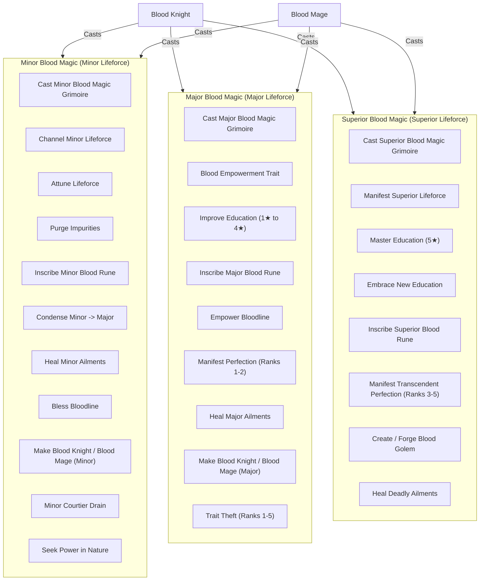

# Blood Magic Tiers

Living technical specification of the three Blood Magic tiers: Minor, Major, and Superior.

## Core Hierarchy

- **Blood Knight (`lifestyle_blood_knight`)**: Devotion-anchored martial peer (*Fire and Sword*). Casts **Minor Magic**, **Major Magic**, and **Superior Magic**.
- **Blood Mage (`lifestyle_blood_mage`)**: Devotion-anchored occult peer (*Shepherd of the Faithful*). Casts **Minor Magic**, **Major Magic**, and **Superior Magic**.

---

## Tier 1: Minor Blood Magic

Requires Minor Lifeforce (`lifeforce_modifier_minor`). Accessible to both **Blood Mages** and **Blood Knights**.

| Action / Ritual | Interface | Cost / Prerequisite | Effect | XP Gain |
| --- | --- | --- | --- | --- |
| **Cast Minor Magic Grimoire** | Decision (`bm_cast_blood_magic_minor_decision`) | Minor Lifeforce | Opens minor rituals event grimoire (`bm_cast_blood_magic_minor.001`). | None |
| **Channel Minor Lifeforce** | Grimoire Option | 75 Piety + Minor Lifeforce | Grants stat buff event chain (`bm_channel_lifeforce_enlightenment_minor.001`). | +1 Enlightenment |
| **Attune Lifeforce** | Grimoire Option | 25 Piety + Minor Lifeforce | Sets affinity modifier for bonus XP growth in chosen track. | None |
| **Purge Bodily Impurities** | Grimoire Option | 50 Piety + Minor Lifeforce | Cleanses minor wounds, scars, illness, lovers pox, gout, and bad traits (`beauty_bad`, `intellect_bad`, `physique_bad`, `dull`, `weak`). | +2 Benediction/Bloodline (Mage) +2 Enlightenment (Knight) |
| **Condense Lifeforce** | Grimoire Option | 100 Piety + Minor Lifeforce | Converts 1 Minor Lifeforce into 1 Major Lifeforce (`lifeforce_modifier_major`). | +2 Ancient |
| **Inscribe Minor Blood Rune** | Grimoire Option | Minor Lifeforce, Piety level >= 2, 5-yr CD | Inscribes `minor_blood_rune_modifier` (+10% Devotion impact). | +4 Ancient |
| **Heal Minor Ailments** | Interaction (`bm_heal_ailment`) | 15 Piety + Minor Lifeforce | Cures minor affliction (`wounded_1`, `ill`, `lovers_pox`, `gout_ridden`, `scarred`) on self or ally. | Self: +2 Enlightenment Ally (Mage): +2 Benediction Ally (Knight): +1 Vanguard, +1 Benediction |
| **Bless Bloodline** | Interaction (`bm_bless_bloodline_interaction`) | 35 Piety + Minor Lifeforce, 10-yr buff | Bestows `bm_blessed_blood_modifier` (+1 all stats, +10% fertility, +0.25 health) on child or dynasty kin. | Mage: +2 Bloodline Knight: +2 Vanguard |
| **Make Blood Knight (Minor)** | Interaction (`make_blood_knight_interaction`) | 250 Piety + Minor Lifeforce (Knight actor) | Bestows `lifestyle_blood_knight` on sworn knight/courtier. | +2 Vanguard |
| **Grant Blood Magic (Minor)** | Interaction (`grant_blood_magic_interaction`) | 250 Piety + Minor Lifeforce (Mage actor) | Bestows `lifestyle_blood_mage` on uninitiated courtier/kin. | +2 Bloodline |
| **Minor Lifedrain** | Interaction (`lifedrain_courtier_event_interaction`) | 25 Piety, 3-mo CD | Siphons Minor Lifeforce from courtier/prisoner. Victim gets `lifedrained_modifier`. (Mage: Intrigue/Learning; Knight: Prowess duel). | Mage: +1 Hematurgy Knight: +1 Slaughter |
| **Seek Power** | Decision (`seek_power_decision`) | Cooldown (2 yrs landed, 1 yr wanderer) | Wilderness expedition harvesting Lifeforce and school XP. | Scaled School XP |

---

## Tier 2: Major Blood Magic

Requires Major Lifeforce (`lifeforce_modifier_major`) and Devotion level >= 1. Accessible to both **Blood Mages** and **Blood Knights**.

| Action / Ritual | Interface | Cost / Prerequisite | Effect | XP Gain |
| --- | --- | --- | --- | --- |
| **Cast Major Magic Grimoire** | Decision (`bm_cast_blood_magic_major_decision`) | Major Lifeforce, Piety level >= 1 | Opens major rituals event grimoire (`bm_cast_blood_magic_major.001`). | None |
| **Blood Empowerment** | Grimoire Option | 150 Piety + Major Lifeforce | Unlocks secondary lifestyle trait `lifestyle_blood_empowerment` and its 5 specialized tracks. | +3 Enlightenment |
| **Improve Education (1★–4★)** | Grimoire Option | Scaled Piety + Major Lifeforce, 2-yr CD | Upgrades primary education trait star tier (up to tier 4) via mental duel. | +5 Enlightenment |
| **Inscribe Major Blood Rune** | Grimoire Option | 200 Piety + Major Lifeforce, Minor Rune active, 5-yr CD | Upgrades Minor Blood Rune to `major_blood_rune_modifier` (+20% Devotion impact). | +5 Ancient |
| **Empower Bloodline** | Grimoire Option | 350 Piety + Major Lifeforce, house head, 3-yr CD | Bestows realm/dynasty-wide stat bonuses (`bm_channel_lifeforce_bloodline.001`). | Mage: +5 Bloodline Knight: +5 Vanguard |
| **Manifest Perfection** | Grimoire Option | Scaled Piety + Major Lifeforce, 5-yr CD | Manifests positive congenital traits (Beauty, Physique, Intellect) up to rank 2. | Mage: +4 Bloodline Knight: +4 Vanguard |
| **Heal Major Ailments** | Interaction (`bm_heal_ailment`) | 35 Piety + Major Lifeforce | Cures severe condition or old age ailment (`blind`, `incapable`, `infirm`, `withering_mind`, `clouded_eyes`, `fragile_bones`, `faltering_heart`, `wounded_2`, `weak`, etc.) on self or ally. | Self: +4 Enlightenment Ally (Mage): +4 Benediction Ally (Knight): +2 Vanguard, +2 Benediction |
| **Make Blood Knight (Major)** | Interaction (`make_blood_knight_interaction`) | 100 Piety + Major Lifeforce (Knight actor) | Bestows `lifestyle_blood_knight` on sworn knight/courtier. | +4 Vanguard |
| **Grant Blood Magic (Major)** | Interaction (`grant_blood_magic_interaction`) | 100 Piety + Major Lifeforce (Mage actor) | Bestows `lifestyle_blood_mage` on uninitiated courtier/kin. | +4 to +5 Bloodline |
| **Trait Theft (Ranks 1–5)** | Interaction (`trait_drain_prisoner_event_interaction`) | Scaled Piety + Major Lifeforce, 60-day CD | Steals congenital trait (ranks 1–5: Quick to Genius, Comely to Beautiful, Hale to Herculean) from prisoner via duel. | Mage: +2 Hematurgy Knight: +2 Slaughter |

---

## Tier 3: Superior Blood Magic

Requires Superior Lifeforce (`lifeforce_modifier_superior`) and Devotion level >= 2. Accessible to both **Blood Mages** and **Blood Knights**.

| Action / Ritual | Interface | Cost / Prerequisite | Effect | XP Gain |
| --- | --- | --- | --- | --- |
| **Cast Superior Magic Grimoire** | Decision (`bm_cast_blood_magic_superior_decision`) | Superior Lifeforce, Piety level >= 2 | Opens superior rites modal (`bm_cast_blood_magic_superior.001`). | None |
| **Manifest Superior Lifeforce** | Decision (`bm_manifest_superior_lifeforce_decision`) | 250 Piety + 1 Minor & 1 Major Lifeforce, Piety level >= 3 | Distills high-tier lifeforce into Superior Lifeforce via Learning duel. | +2 to +8 Ancient |
| **Master Education (5★)** | Grimoire Option | Scaled Piety + Superior Lifeforce, 4★ education, 2-yr CD | Ascends 4★ education to legendary 5★ tier via mental duel. | +10 Enlightenment (+10 on win) |
| **Embrace New Education** | Grimoire Option | 1000 Piety + Superior Lifeforce, 5★ education, 2-yr CD | Grants a secondary 1-star education trait in a new discipline. | +10 Enlightenment |
| **Inscribe Superior Blood Rune** | Grimoire Option | 400 Piety + Superior Lifeforce, Major Rune active, 5-yr CD | Upgrades Major Blood Rune to `superior_blood_rune_modifier` (+30% Devotion impact). | +10 Ancient |
| **Manifest Apex Perfection** | Grimoire Option | Scaled Piety + Superior Lifeforce, 5-yr CD | Manifests congenital traits at apex ranks 3 to 5 (Genius, Herculean, Beautiful, and beyond). | Mage: +6 Bloodline, +2 Enlightenment Knight: +6 Vanguard, +2 Enlightenment |
| **Create / Forge Blood Golem** | Decision / Grimoire Option (`blood_golem_creation_decision`) | 500 Piety + Superior Lifeforce, 3-yr CD | Synthesizes and shapes an immortal artificial champion in cadet house `bm_house_golem`. | Mage: +5 Bloodline Knight: +5 Vanguard |
| **Heal Deadly Ailments** | Interaction (`bm_heal_ailment`) | 100 Piety + Minor & Major Lifeforce | Cures fatal ailments (`cancer`, `bubonic_plague`, `leper`, `disfigured`, `wounded_3`, etc.) on self or ally. | +8 Benediction |

---

## Class Harvesting & Progression Differences

| Dimension | Blood Mage | Blood Knight |
| --- | --- | --- |
| **Magic Casting** | Minor, Major, Superior | Minor, Major, Superior |
| **Lifeforce Generation** | Active distillation, lethal prisoner execution, courtier siphoning | Single-combat duel kills (Major Lifeforce + 25% Superior chance on prowess >= 35 or blood traits), battle victories (33% Minor), ambient yearly condensation (~33% Minor) |
| **Exclusive Tracks** | `bloodline` (Domain limit, dynasty gold, construction, dev) `hematurgy` (Schemes, dread, tyranny reduction) | `vanguard` (Army advantage, martial, speed, pursuit, knight limit) `slaughter` (Prowess, knight effectiveness, dread, knight limit) |
| **Shared Tracks** | `ancient`, `benediction`, `enlightenment` | `ancient`, `benediction`, `enlightenment` |
| **Secondary Lifestyle** | `lifestyle_blood_empowerment` (all 5 tracks) | `lifestyle_blood_empowerment` (all 5 tracks) |
| **Initiation** | Initiates apprentices as Blood Mages (Major + 100p OR Minor + 250p) | Initiates squires/knights as Blood Knights (Major + 100p OR Minor + 250p) |
